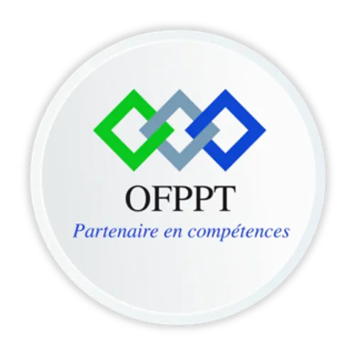
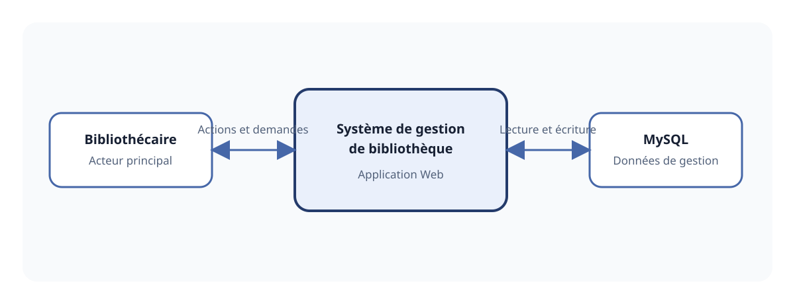
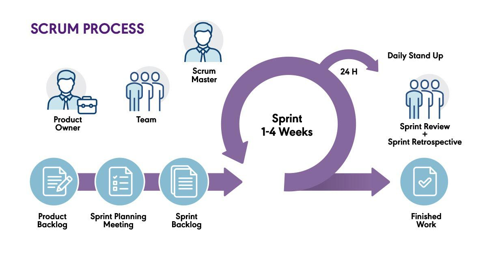
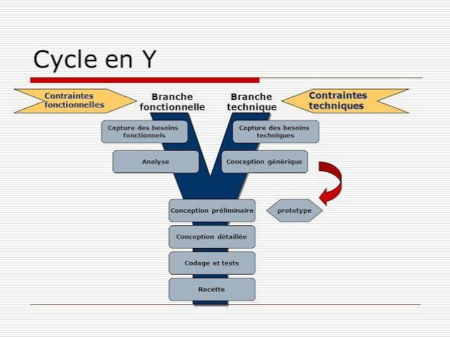
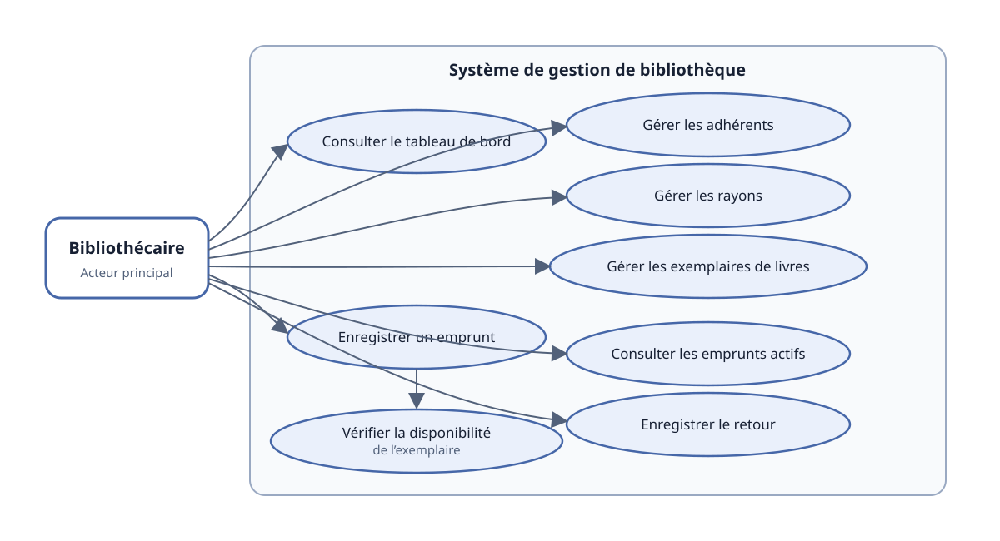
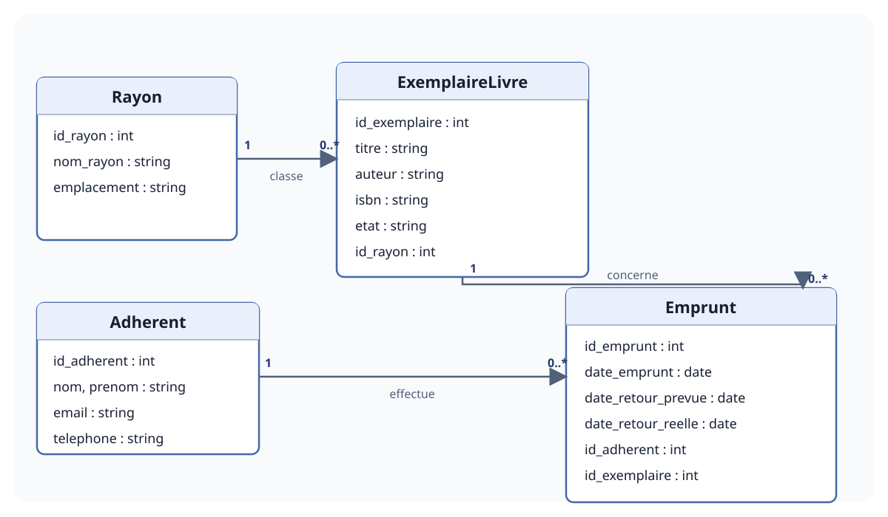

<!-- _class: title-slide -->

# Rapport de projet

### Projet fil rouge · Gestion de bibliothèque  

El faquihi Ayoub
 · Encadrant : Fouad ESSARAJ

  
  

---

## Remerciements

---

## Introduction

---

## Contexte du projet

<!-- _class: image-only -->

---

## Cahier des charges

---
## Methode de travail
---
<!-- _class: image-only -->

## Scrum

---
<!-- _class: image-only -->

## Processus 2TUP

---
<!-- _class: image-only -->

## Design Thinking

---

## Planification

---

## Branche fonctionnelle

---

## Carte d'empathie

---

## Définition du problème

---

## Idéation

---

## Diagramme de cas d'utilisation

<!-- _class: image-only -->

---

## Stack technologique · Projet technique

- **Backend** · PHP
- **Frontend** · HTML · JavaScript · Tailwind CSS
- **API** · HTTP · JSON
- **Persistance du prototype** · fichier JSON
- **Base relationnelle décrite par le modèle** · MySQL / MariaDB

---

## Architecture · Projet technique

**Interface HTML / JavaScript**

↓ Requêtes HTTP / réponses JSON

**ControllerThematique**

↓

**ThematiqueService**

↓

**ThematiqueDao** → **thematique.json**

`BaseService` existe dans le dossier, mais il est vide et n’est pas utilisé par
`ThematiqueService`.

---

## Prototype · Projet technique

- **Domaine cible** · Animateurs · Thématiques · Épisodes
- **API réalisée** · Consultation et création des thématiques
- **Données utilisées** · Nom et description d’une thématique
- **Persistance actuelle** · Fichier JSON
- Le MCD et le script SQL décrivent les trois entités ; le prototype ne les
  gère pas encore toutes.

---

## Relations · Projet technique

- **Animateur** · anime un ou plusieurs épisodes
- **Épisode** · est animé par un seul animateur
- **Thématique** · peut regrouper zéro ou plusieurs épisodes
- **Épisode** · appartient à une seule thématique

---

## Structure technique · Projet technique

- `controllerThematique.php` reçoit la requête.
- `ThematiqueService` coordonne l’opération et appelle `ThematiqueDao`.
- Le DAO lit et écrit les données JSON, puis retourne des objets `Thematique`.
- L’API actuelle expose `GET` et `POST` pour les thématiques.

---

<!-- _class: image-only -->

<!-- _class: image-only -->

## Diagramme de classes · Projet fil rouge

---

## Maquettes

---

## Interfaces

---

## Conclusion

- Le projet fil rouge porte sur la gestion de bibliothèque.
- Le projet technique porte sur un annuaire de podcasts.
- Le prototype podcasts valide la consultation et la création de thématiques
  avec une API PHP et un stockage JSON.
