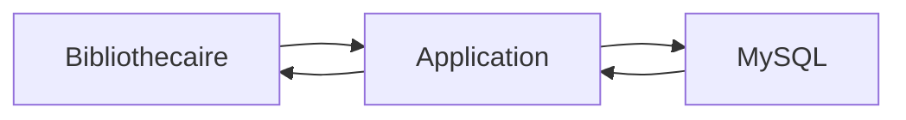
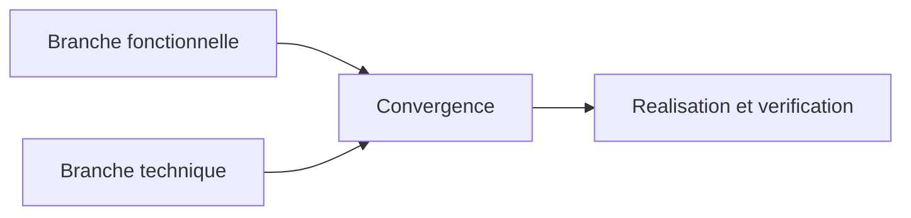
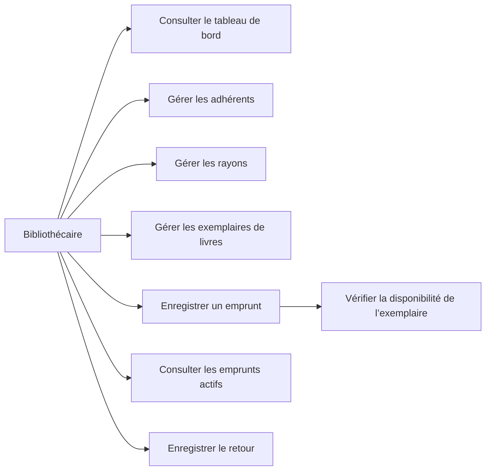
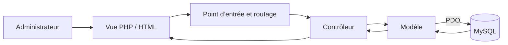
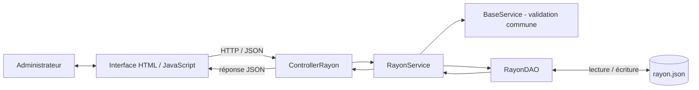
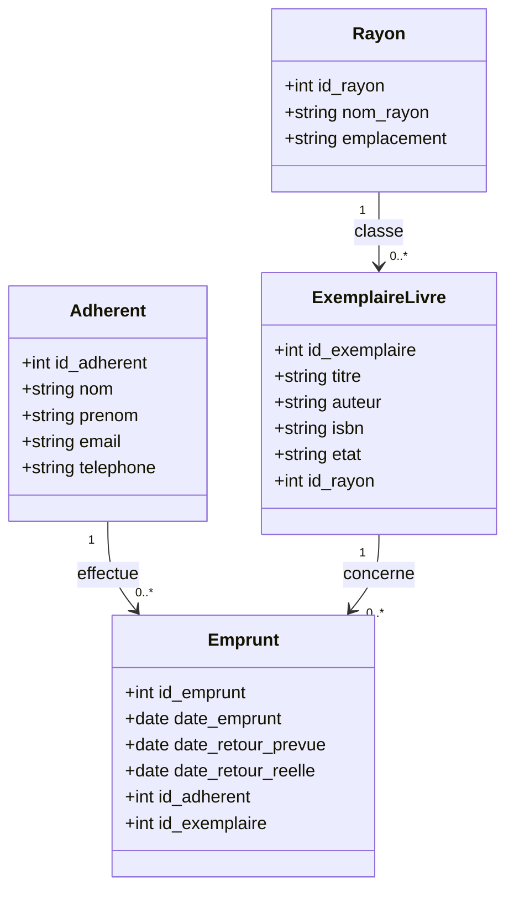

# Rapport final — Gestion de bibliothèque

#### Table des matières

- [Remerciements](#remerciements)
- [Introduction](#introduction)
- [Contexte du projet](#contexte-du-projet)
- [Cahier des charges](#cahier-des-charges)
- [Méthodologie de travail](#méthodologie-de-travail)
  - [Méthodologie Scrum](#méthodologie-scrum)
  - [Processus 2TUP](#processus-2tup)
  - [Design Thinking](#design-thinking)
- [Planification](#planification)
- [Branche fonctionnelle](#branche-fonctionnelle)
  - [Carte d'empathie](#carte-dempathie)
  - [Définition du problème](#définition-du-problème)
  - [Idéation](#idéation)
  - [Diagramme de cas d'utilisation](#diagramme-de-cas-dutilisation)
- [Branche technique](#branche-technique)
  - [Stack technologique](#stack-technologique)
  - [Architecture logicielle](#architecture-logicielle)
  - [Prototype (fonctionnalités, classes)](#prototype-fonctionnalités-classes)
- [Conception](#conception)
  - [Diagramme de classes](#diagramme-de-classes)
  - [Maquettes](#maquettes)
- [Réalisation](#réalisation)
  - [Interfaces](#interfaces)
- [Conclusion](#conclusion)

## Remerciements

Nous remercions l’équipe pédagogique de Solicode pour son accompagnement et
les personnes qui ont contribué à la réflexion autour de ce projet. Sa
réalisation nous a permis de mettre en pratique l’analyse, la conception et le
développement d’une application de gestion.

## Introduction

Ce rapport présente le projet fil rouge de gestion de bibliothèque et
l’évolution de sa conception technique. L’application principale permet à un
administrateur de gérer les adhérents, les rayons, les exemplaires de livres,
les emprunts et les retours. Une évolution distincte du module de classification
des rayons illustre le passage d’une organisation PHP MVC à une architecture
en trois tiers comprenant un contrôleur, des services et un DAO.

Les différentes versions de classification sont décrites comme des étapes
d’apprentissage. Le prototype 3-tiers des rayons utilise son propre stockage
JSON et n’est pas présenté comme une intégration dans l’application principale
MySQL.

## Contexte du projet

Une bibliothèque doit organiser ses collections, retrouver les exemplaires et
suivre leur circulation entre les adhérents. Le projet répond à ces besoins à
l’aide d’une application web d’administration : l’administrateur gère les
données de la bibliothèque, enregistre les emprunts et traite les retours.

Le dépôt contient deux périmètres liés au même projet :

- **Application principale `library-admin`** : application PHP organisée en
  MVC, avec MySQL et PDO, couvrant le tableau de bord, les adhérents, les
  rayons, les livres, les emprunts et les retours.
- **Évolution du module Rayon** : versions successives qui isolent la gestion
  des rayons et explorent différentes structures, jusqu’à une version
  3-tiers autonome avec stockage JSON.

Cette distinction est importante : les données et le thème restent ceux de
la bibliothèque, tandis que les versions du module Rayon servent à comparer
les responsabilités et l’organisation du code.

### Diagramme de contexte

Le diagramme présente les interactions de l’application principale avec son
acteur et son système de persistance. Le prototype autonome du module Rayon,
qui utilise un fichier JSON, reste hors du périmètre de cette application.

*Figure — Diagramme de contexte de l’application principale.*

## Cahier des charges

### Objectif général

Fournir à l’administrateur une interface web pour gérer les ressources de la
bibliothèque et suivre les prêts d’exemplaires aux adhérents.

### Acteur principal

- **Administrateur / bibliothécaire** : gère les collections, les adhérents,
  les emprunts et les retours.

### Besoins fonctionnels

- Afficher un tableau de bord avec le nombre d’adhérents, d’exemplaires, les
  emprunts actifs et les emprunts en retard.
- Créer, consulter, modifier et supprimer des adhérents.
- Créer, consulter, modifier et supprimer des rayons.
- Gérer les exemplaires de livres et les associer à un rayon.
- Consulter les emprunts et enregistrer un emprunt pour un adhérent et un
  exemplaire disponible.
- Consulter les emprunts actifs et enregistrer le retour d’un exemplaire.

### Données principales

- **Adhérent** : identifiant, nom, prénom, adresse courriel et téléphone.
- **Rayon** : identifiant, nom et emplacement.
- **Exemplaire de livre** : identifiant, titre, auteur, ISBN, état et rayon.
- **Emprunt** : identifiant, date d’emprunt, date de retour prévue, date de
  retour réelle éventuelle, adhérent et exemplaire emprunté.

Un rayon peut contenir plusieurs exemplaires. Un adhérent peut avoir plusieurs
emprunts au fil du temps. Chaque emprunt concerne un adhérent et un exemplaire.
Un exemplaire sans date de retour réelle est considéré comme emprunté et n’est
pas disponible pour un nouvel emprunt.

### Contraintes et règles de gestion

- Les opérations de gestion sont destinées à l’interface d’administration.
- Les données de l’application principale sont stockées dans MySQL.
- Les opérations sur les données relationnelles utilisent PDO et des requêtes
  préparées dans les modèles.
- Le module Rayon 3-tiers est un prototype pédagogique autonome : il utilise
  un fichier JSON temporairement comme persistance et ne remplace pas la base
  MySQL de l’application principale.
- Les références entre adhérents, exemplaires et emprunts doivent respecter
  les clés étrangères définies dans le schéma.

## Méthodologie de travail

### Méthodologie Scrum

Scrum propose de découper le travail en étapes courtes, de rendre l’avancement
visible et d’adapter les priorités selon les résultats. Les résumés ci-dessous
suivent les quatre dossiers de session du projet fil rouge. Ils décrivent les
livrables observés ; les dossiers ne précisent pas les dates ni la durée des
sprints.

#### Sprint 1 — Session 1 : application de gestion de bibliothèque

Réalisation de l’application d’administration en PHP selon une organisation
MVC, avec une base MySQL et un accès aux données par PDO. Le périmètre couvre
le tableau de bord, les adhérents, les rayons, les livres, les emprunts et les
retours. Le schéma relationnel définit les liens entre ces données.

#### Sprint 2 — Session 2 : API et repository pour les rayons

Reprise isolée de la gestion des rayons pour pratiquer les échanges HTTP/JSON,
les méthodes GET, POST, PUT et DELETE, l’encapsulation de l’entité `Rayon` et
la séparation de l’accès MySQL dans `RayonRepository`. Cette session met
l’accent sur les concepts d’API et de repository sans changer le domaine
bibliothèque.

#### Sprint 2 — Session 3 : contrôleur et stockage JSON

Nouvelle version autonome du module Rayon avec une interface web, un
`ControllerRayon`, une entité `Rayon` et une classe `GestionRayon` qui lit et
écrit les données dans un fichier JSON. Les opérations démontrées dans cette
version sont la consultation et la création de rayons ; le test PHP vérifie
ces opérations.

#### Sprint 4 — Session 4 : architecture 3-tiers

Refactorisation du module Rayon en séparant le contrôleur, le service métier,
`BaseService` pour les validations communes et `RayonDAO` pour la persistance
JSON. Cette version prend en charge le CRUD complet, normalise et valide les
données dans le service, et teste le service/DAO avec un fichier JSON
temporaire.

### Processus 2TUP

La méthode 2TUP sépare l’analyse fonctionnelle de l’étude technique, puis
réunit ces deux branches lors de la conception et de la réalisation.

*Figure — Adaptation du processus 2TUP au projet de gestion de bibliothèque.*

La branche fonctionnelle couvre le classement des exemplaires par rayon, la
gestion des adhérents et le cycle d’emprunt-retour. La branche technique
décrit d’abord l’application PHP MVC et sa base MySQL, puis l’étude
architecturale du module Rayon. Dans cette dernière, les préoccupations
fonctionnelles sont conservées tandis que la structure de code évolue vers
trois tiers.

### Design Thinking

Le Design Thinking est une démarche centrée sur les besoins des utilisateurs,
qui comprend l’empathie, la définition du problème, l’idéation, le prototypage
et les tests. Appliquée au projet, elle aide à formuler les tâches courantes
de l’administrateur : classer un exemplaire, retrouver une information sur un
adhérent et savoir si un livre est disponible.

La carte d’empathie et les besoins ci-dessous sont une synthèse de conception
à partir du périmètre fonctionnel du dépôt. Les documents disponibles ne
rapportent pas d’entretiens ou de tests utilisateurs ; ces éléments ne sont
donc pas présentés comme des résultats de recherche auprès d’utilisateurs.

## Planification

| Étape | Travail | Résultat |
|---|---|---|
| Analyse | Identifier les acteurs, les données et les règles de prêt | Cahier des charges et modèle relationnel |
| Application principale | Organiser les pages et traitements PHP en MVC | Gestion de bibliothèque connectée à MySQL |
| Étude du module Rayon | Isoler le CRUD et faire évoluer l’organisation du code | Versions successives du module |
| Architecture 3-tiers | Séparer contrôleur, services, DAO et stockage | Prototype Rayon autonome |
| Vérification | Tester les règles de service et les opérations sur les données | Tests ciblés du service et du DAO |

Ce tableau décrit la progression technique visible dans les dossiers. Il
n’associe pas de dates ou de durée aux étapes, car ces informations ne sont
pas documentées.

## Branche fonctionnelle

### Carte d'empathie

| Dimension | Administrateur / bibliothécaire |
|---|---|
| Pense et ressent | Veut garder les collections organisées et savoir quels exemplaires sont disponibles |
| Voit | Des rayons, des exemplaires, des adhérents et des prêts en cours |
| Dit et fait | Enregistre les livres, les prêts et les retours |
| Difficultés | Éviter les erreurs de classement et les prêts d’un exemplaire déjà emprunté |
| Bénéfices attendus | Retrouver les informations et suivre rapidement la circulation des livres |

Cette carte est une hypothèse de conception liée à l’acteur principal, et non
le compte rendu d’une enquête utilisateur.

### Définition du problème

Comment aider un bibliothécaire à organiser les exemplaires par rayon, gérer
les adhérents et suivre la disponibilité des livres tout au long du cycle
d’emprunt et de retour ?

### Idéation

La solution retenue s’organise autour des fonctions suivantes :

- un tableau de bord synthétise l’activité et les retards ;
- des interfaces dédiées permettent la gestion des adhérents, rayons et
  exemplaires ;
- un emprunt associe un adhérent à un exemplaire disponible et à des dates ;
- le retour renseigne la date de retour réelle et libère l’exemplaire ;
- le module Rayon sert de support à l’expérimentation d’architectures
  différentes sans changer le domaine fonctionnel.

### Diagramme de cas d'utilisation

*Figure — Principaux cas d’utilisation de l’application.*

## Branche technique

### Stack technologique

**Application principale :**

- **Backend** : PHP.
- **Architecture** : MVC avec contrôleurs, modèles et vues.
- **Accès aux données** : PDO.
- **Base de données** : MySQL, avec le schéma `gestion_bibliotheque`.
- **Frontend** : HTML5, CSS3 et JavaScript.

**Prototype autonome du module Rayon en 3-tiers :**

- **Interface** : HTML et JavaScript, avec Tailwind CSS chargé depuis CDN.
- **API** : contrôleur PHP recevant les requêtes HTTP et échangeant du JSON.
- **Logique métier** : `RayonService`, qui hérite de `BaseService`.
- **Accès aux données** : `RayonDAO`.
- **Persistance du prototype** : fichier JSON.
- **Vérification** : script de test PHP du service et du DAO.

Ces technologies décrivent bien deux niveaux du projet : l’application
principale MySQL/MVC et le prototype Rayon 3-tiers/JSON. Le second n’est pas
présenté comme une migration complète de toute l’application.

### Architecture logicielle

#### Application principale — MVC

L’application `library-admin` utilise une organisation MVC. Le point d’entrée
`public/index.php` sélectionne un contrôleur et une action ; les contrôleurs
préparent les données, appellent les modèles et affichent les vues. Les
modèles utilisent PDO pour interroger la base MySQL.

*Figure — Flux MVC de l’application principale.*

Dans cette version, la logique d’accès aux données se trouve principalement
dans les modèles (`Adherent`, `Rayon`, `Livre`, `Emprunt`). Les vues sont
séparées par fonctionnalité et partagent des éléments de mise en page.

#### Module Rayon — évolution vers le 3-tiers

La version `rayon-classification-3tier` conserve le même domaine — les rayons
de bibliothèque — mais répartit les traitements en couches distinctes :

1. **Présentation** : la page HTML et `app.js` affichent les rayons et
   envoient les opérations CRUD à l’API.
2. **Contrôleur** : `controllerRayon.php` lit les requêtes, délègue le
   traitement et renvoie des réponses JSON.
3. **Services** : `RayonService` applique les règles métier et s’appuie sur
   `BaseService` pour les validations et la normalisation communes.
4. **DAO** : `RayonDAO` lit et écrit les données, sans porter les règles
   métier du service.
5. **Stockage** : le prototype utilise `backend/data/rayon.json`.

*Figure — Architecture en trois tiers du prototype autonome de gestion des
rayons.*

La séparation permet de tester les règles métier à travers le service sans
dépendre directement de l’interface. Le DAO accepte également un chemin de
fichier configurable, ce qui permet au test d’utiliser un fichier temporaire.
Dans cette version, le stockage est un fichier JSON et non la base MySQL de
l’application principale.

#### Étapes d’évolution du module Rayon

| Version | Organisation observée | Stockage / responsabilité |
|---|---|---|
| Application principale | MVC : contrôleur, modèle, vue | MySQL via PDO |
| `rayon-classification-v2` | Entité `Rayon`, `RayonRepository` et API | Dépôt avec requêtes PDO ; opérations CRUD de l’API |
| `rayon-classification-v3` | Contrôleur API et classe `GestionRayon` | JSON ; lecture et création dans cette version |
| `rayon-classification-3tier` | Contrôleur, `RayonService`, `BaseService`, `RayonDAO` | JSON ; CRUD complet et tests du service |

Ces versions illustrent une évolution de structure et de responsabilités. Les
versions autonomes du module ne remplacent pas le stockage relationnel de
l’application principale.

### Prototype (fonctionnalités, classes)

Le prototype principal met en œuvre les fonctions d’administration définies
dans le cahier des charges : tableau de bord, gestion des adhérents, rayons et
exemplaires, création des emprunts et enregistrement des retours. Le module
Rayon autonome reprend le CRUD du classement dans une architecture 3-tiers.

#### Classes et responsabilités

- **`Adherent`** : accès aux données et opérations CRUD des adhérents dans
  l’application principale.
- **`Rayon`** : accès aux données des rayons dans l’application MVC ; dans le
  prototype 3-tiers, l’entité `Rayon` encapsule l’identifiant, le nom et
  l’emplacement.
- **`Livre`** : opérations sur les exemplaires, leur rayon et leur
  disponibilité.
- **`Emprunt`** : suivi des emprunts, détection des exemplaires empruntés ou
  en retard, et enregistrement des retours.
- **Contrôleurs MVC** : traitent les actions de l’interface principale.
- **`ControllerRayon`** : reçoit les requêtes de l’API du prototype 3-tiers.
- **`BaseService`** : fournit les méthodes communes de validation des textes.
- **`RayonService`** : valide et normalise les données du rayon, puis demande
  au DAO de les persister.
- **`RayonDAO`** : encapsule la lecture, la création, la modification et la
  suppression dans le fichier JSON.

#### Règles métier illustrées

- Le nom d’un rayon est requis ; son emplacement peut être vide.
- Un emprunt ne peut être créé que pour un adhérent valide et un exemplaire
  disponible.
- Un exemplaire est considéré comme disponible lorsqu’il n’a pas d’emprunt
  actif, c’est-à-dire sans date de retour réelle.
- Le retour enregistre la date réelle sur un emprunt encore actif.

## Conception

### Diagramme de classes

Le diagramme suivant représente le modèle relationnel de l’application
principale. Un emprunt relie un adhérent à un exemplaire, et chaque exemplaire
appartient à un rayon.

*Figure — Modèle de données de gestion de bibliothèque.*

### Maquettes

Le code de l’application fournit les vues fonctionnelles, mais aucun fichier
de maquette graphique dédié n’est identifié dans les dossiers consultés. Les
écrans de l’application sont organisés autour des pages suivantes :

- tableau de bord et statistiques ;
- listes, formulaires et fiches des adhérents ;
- listes, formulaires et fiches des rayons et des livres ;
- consultation et création des emprunts ;
- liste des retours et confirmation d’un retour.

Le prototype Rayon dispose également d’une page de liste et d’un formulaire
CRUD intégrés à sa propre interface.

## Réalisation

### Interfaces

L’application principale est une interface web PHP dont le point d’entrée
centralise le routage vers le tableau de bord, les adhérents, les rayons, les
livres, les emprunts et les retours. Les contrôleurs transmettent les données
aux vues correspondantes.

Dans le prototype 3-tiers, l’interface HTML/JavaScript appelle
`controllerRayon.php` en HTTP avec des échanges JSON. Elle permet de consulter
la liste des rayons, d’en ajouter, de les modifier et de les supprimer. Le
serveur PHP intégré peut lancer ce prototype depuis son dossier ; le test
`backend/tests/RayonServiceTest.php` vérifie les opérations du service et du
DAO avec un fichier JSON temporaire.

## Conclusion

Le projet fil rouge porte sur la gestion d’une bibliothèque : organisation des
rayons et des exemplaires, gestion des adhérents et suivi des emprunts et
retours. L’application principale met en œuvre une architecture PHP MVC avec
MySQL et PDO.

L’évolution du module Rayon conserve le même contexte fonctionnel tout en
faisant évoluer la structure du code. La version 3-tiers sépare l’interface,
le contrôleur, les services et l’accès aux données au moyen d’un DAO et d’un
`BaseService`. Son stockage JSON reste propre au prototype pédagogique et ne
doit pas être confondu avec la persistance MySQL de l’application complète.
Cette séparation clarifie les responsabilités et constitue une base pour
faire évoluer l’architecture sans changer le besoin métier.
