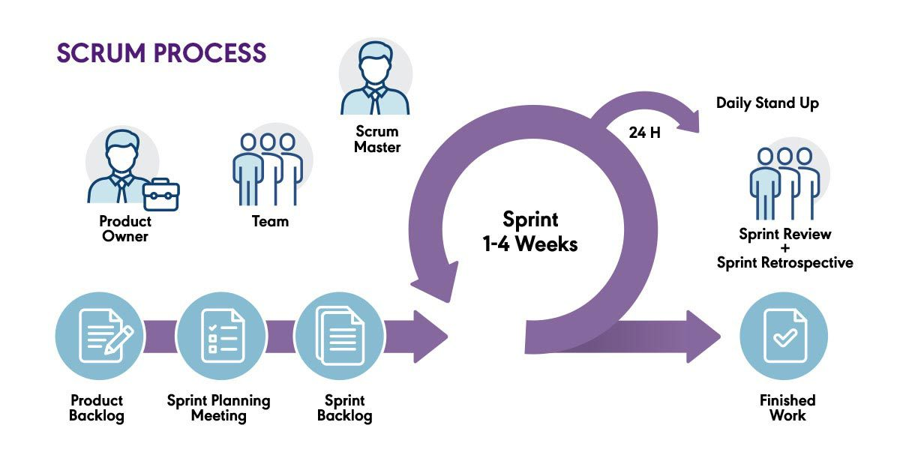

# Méthode de travail

## La méthode SCRUM

La méthodologie Scrum est une approche agile qui permet de gérer un projet de
manière flexible et collaborative, en favorisant la livraison progressive de
fonctionnalités. Elle repose sur l’itération, la priorisation des tâches et la
communication régulière entre les membres de l’équipe. Les quatre sessions
ci-dessous montrent la progression du projet de gestion de bibliothèque et
l’évolution du module Rayon.

*Figure 3 : La méthode SCRUM*

**Principe Scrum :**

- **Transparence** : visibilité complète sur les tâches, les objectifs et l'avancement du projet pour toute l'équipe.
- **Inspection** : évaluation régulière à la fin de chaque sprint afin d'identifier les erreurs, les blocages et les axes d'amélioration.
- **Adaptation** : ajustement du plan de travail en fonction des retours et des résultats obtenus lors des sprints.

**Organisation du projet en sprints :**

Les résumés ci-dessous suivent les quatre dossiers de session du projet fil
rouge. Ils décrivent les livrables et l’évolution technique observés ; les
dossiers ne précisent pas les dates ni la durée des sprints.

### Sprint 1 — Session 1 : application de gestion de bibliothèque

Réalisation de l’application d’administration en PHP selon une organisation
MVC, avec une base MySQL et un accès aux données par PDO. Le périmètre couvre
le tableau de bord, les adhérents, les rayons, les livres, les emprunts et les
retours. Le schéma relationnel définit les liens entre ces données.

### Sprint 2 — Session 2 : API et repository pour les rayons

Reprise isolée de la gestion des rayons pour pratiquer les échanges HTTP/JSON,
les méthodes GET, POST, PUT et DELETE, l’encapsulation de l’entité `Rayon` et
la séparation de l’accès MySQL dans `RayonRepository`. Cette session met
l’accent sur les concepts d’API et de repository sans changer le domaine
bibliothèque.

### Sprint 2 — Session 3 : contrôleur et stockage JSON

Nouvelle version autonome du module Rayon avec une interface web, un
`ControllerRayon`, une entité `Rayon` et une classe `GestionRayon` qui lit et
écrit les données dans un fichier JSON. Les opérations démontrées dans cette
version sont la consultation et la création de rayons ; le test PHP vérifie
ces opérations.

### Sprint 4 — Session 4 : architecture 3-tiers

Refactorisation du module Rayon en séparant le contrôleur, le service métier,
`BaseService` pour les validations communes et `RayonDAO` pour la persistance
JSON. Cette version prend en charge le CRUD complet, normalise et valide les
données dans le service, et teste le service/DAO avec un fichier JSON
temporaire.
